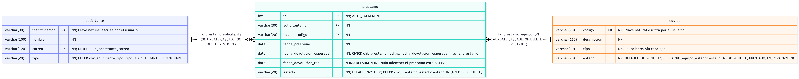

# Etapa 1 — Análisis, diseño y arquitectura
 
## Contenido
 
| Sección | Tema |
|:---:|---|
| [9.1](#91-identificación) | Identificación |
| [9.2](#92-descripción-del-problema) | Descripción del problema |
| [9.3](#93-requerimientos-funcionales) | Requerimientos funcionales |
| [9.4](#94-reglas-de-negocio) | Reglas de negocio |
| [9.5](#95-entidades-atributos-y-relaciones) | Entidades, atributos y relaciones |
| [9.6](#96-diagrama-de-clases-uml) | Diagrama de clases UML |
| [9.7](#97-modelo-relacional) | Modelo relacional |
| [9.8](#98-arquitectura-propuesta) | Arquitectura propuesta |
| — | [Código de la Etapa 1](#código-de-la-etapa-1) y [Distribución del trabajo](#distribución-del-trabajo) |
 
---
 
## 9.1 Identificación
 
| Campo | Detalle |
|---|---|
| **Caso asignado** | Caso 1 |
| **Integrante 1** | Jafeth Godinez Matarrita |
| **Integrante 2** | Jorge Fernandez Miranda |
| **Repositorio** | <https://github.com/JafethSasan/examen1progra3-Fernandez-Godinez> |
 
---
 
## 9.2 Descripción del problema
 
### Problema que se desea resolver
 
El problema que se desea resolver con el programa es la falta de un sistema centralizado para administrar
y controlar los préstamos de equipos tecnológicos, permitiendo llevar un registro organizado de los solicitantes,
los equipos disponibles y los préstamos realizados.
 
### Quién utilizaría el sistema
 
El sistema sería utilizado principalmente por dos tipos de usuarios:
 
| Usuario | Para qué solicita equipos | Límite de préstamos activos |
|---|---|:---:|
| **Estudiantes** | Realizar actividades académicas | **2** simultáneos |
| **Funcionarios** | Realizar sus labores institucionales | **4** simultáneos |
 
### Principales operaciones
 
| N.º | Operación | Descripción |
|:---:|---|---|
| 1 | **Gestión de solicitantes** | Registrar, consultar, listar y actualizar la información de los estudiantes y funcionarios que solicitan equipos tecnológicos. |
| 2 | **Gestión de equipos tecnológicos** | Registrar nuevos equipos, consultar sus características, listar los equipos disponibles y actualizar su información o estado. |
| 3 | **Registro de préstamos** | Registrar el préstamo de un equipo a un solicitante, verificando que el solicitante exista, que el equipo esté disponible y que se cumplan las reglas establecidas. |
| 4 | **Control de préstamos activos** | Consultar los préstamos que todavía no han sido devueltos, incluyendo la información del solicitante y del equipo correspondiente. |
| 5 | **Gestión de devoluciones** | Registrar la devolución de un equipo, actualizar la fecha de devolución real y cambiar el estado del préstamo y del equipo. |
| 6 | **Validación de reglas de negocio** | Impedir préstamos de equipos no disponibles, evitar registros duplicados y controlar la cantidad máxima de préstamos activos según el tipo de solicitante. |
| 7 | **Persistencia de la información** | Almacenar y consultar los datos mediante una base de datos MySQL, utilizando Java y JDBC para realizar las operaciones. |
 
---
 
## 9.3 Requerimientos funcionales
 
### Gestión de solicitantes
 
| ID | Requerimiento | Descripción |
|:---:|---|---|
| **RF01** | Registro de solicitantes | El sistema debe permitir registrar solicitantes, incluyendo su identificación, nombre, correo electrónico y tipo de solicitante (estudiante o funcionario). |
| **RF02** | Consulta de solicitantes | El sistema debe permitir buscar un solicitante por su identificación y consultar su información registrada. |
| **RF03** | Listado de solicitantes | El sistema debe permitir visualizar la lista de solicitantes registrados. |
| **RF04** | Actualización de solicitantes | El sistema debe permitir modificar la información de los solicitantes existentes. |
 
### Gestión de equipos
 
| ID | Requerimiento | Descripción |
|:---:|---|---|
| **RF05** | Registro de equipos | El sistema debe permitir registrar equipos tecnológicos, incluyendo su código, descripción, tipo y estado. |
| **RF06** | Consulta y listado de equipos | El sistema debe permitir consultar un equipo por su código y visualizar los equipos registrados, incluyendo aquellos que estén disponibles, prestados o en reparación. |
| **RF07** | Actualización de equipos | El sistema debe permitir modificar la información de los equipos y actualizar su estado. |
 
### Gestión de préstamos y devoluciones
 
| ID | Requerimiento | Descripción |
|:---:|---|---|
| **RF08** | Registro de préstamos | El sistema debe permitir registrar préstamos de equipos a solicitantes existentes, indicando la fecha del préstamo y la fecha esperada de devolución. |
| **RF09** | Validación de disponibilidad | Antes de registrar un préstamo, el sistema debe verificar que el equipo exista y se encuentre disponible. |
| **RF10** | Control del límite de préstamos | El sistema debe impedir que un solicitante supere la cantidad máxima de préstamos activos permitida: dos para estudiantes y cuatro para funcionarios. |
| **RF11** | Validación de fechas | El sistema debe comprobar que la fecha esperada de devolución sea posterior a la fecha del préstamo y cumpla con las validaciones temporales definidas para la operación. |
| **RF12** | Consulta de préstamos activos | El sistema debe permitir consultar los préstamos que un solicitante mantiene activos, mostrando la información correspondiente al equipo prestado. |
| **RF13** | Registro de devoluciones | El sistema debe permitir registrar la devolución de un equipo, guardar la fecha real de devolución y actualizar el estado del préstamo a `DEVUELTO`. |
| **RF14** | Actualización de disponibilidad | Al registrar correctamente una devolución, el sistema debe cambiar el estado del equipo a `DISPONIBLE`. |
 
### Requerimientos transversales
 
| ID | Requerimiento | Descripción |
|:---:|---|---|
| **RF15** | Prevención de registros duplicados | El sistema debe impedir el registro de solicitantes con identificaciones existentes y de equipos con códigos duplicados. |
| **RF16** | Persistencia de datos | El sistema debe almacenar y recuperar la información de solicitantes, equipos y préstamos mediante una base de datos MySQL. |
| **RF17** | Manejo de errores y validaciones | El sistema debe informar cuando una operación no pueda completarse por datos inválidos, registros inexistentes, falta de disponibilidad o incumplimiento de las reglas de negocio. |
 
---
 
## 9.4 Reglas de negocio
 
### Solicitantes
 
| ID | Regla | Operaciones donde se aplica | Si se viola |
|:---:|---|---|---|
| **RN-01** | Identificación, nombre y correo son obligatorios (se les hace `trim`). | Registrar y actualizar solicitante | `ValidacionException`: “El campo ‘X’ es obligatorio.” |
| **RN-02** | El correo debe tener formato válido (`texto@dominio.ext`, sin espacios). | Registrar y actualizar solicitante | `ValidacionException`: “El correo electrónico no tiene un formato válido.” |
| **RN-03** | El tipo es obligatorio: `ESTUDIANTE` o `FUNCIONARIO`. | Registrar y actualizar solicitante | `ValidacionException`: “Debe seleccionar ESTUDIANTE o FUNCIONARIO.” |
| **RN-04** | La identificación es única. | Registrar solicitante | `ValidacionException`: “Ya existe un solicitante con esa identificación.” Si algo se escapa, el error 1062 de MySQL se traduce a `DatosException`. |
| **RN-05** | El solicitante debe existir. | Actualizar solicitante, registrar préstamo, consultar préstamos activos | `ValidacionException`: “No existe el solicitante indicado.” (o “...con esa identificación.”) |
 
### Equipos
 
| ID | Regla | Operaciones donde se aplica | Si se viola |
|:---:|---|---|---|
| **RN-06** | Código, descripción y tipo son obligatorios. Si el estado viene vacío, se asigna `DISPONIBLE`. | Registrar y actualizar equipo | `ValidacionException`: “El campo ‘X’ es obligatorio.” |
| **RN-07** | El código es único. | Registrar equipo | `ValidacionException`: “Ya existe un equipo con ese código.” (con respaldo del error 1062) |
| **RN-08** | Un equipo nuevo no puede registrarse como `PRESTADO`. | Registrar equipo | `ValidacionException`: “Un equipo nuevo no puede registrarse como PRESTADO...” |
| **RN-09** | El equipo debe existir. | Actualizar equipo, cambiar estado, registrar préstamo | `ValidacionException`: “No existe un equipo con ese código.” (o “...el equipo indicado.”) |
| **RN-10** | `PRESTADO` solo lo asigna el préstamo, nunca a mano. | Actualizar equipo (si pasa de otro estado a `PRESTADO`) y cambiar estado (cualquier intento) | `ValidacionException`: “El estado PRESTADO solo se asigna al registrar un préstamo.” |
| **RN-11** | Un equipo prestado no puede cambiar de estado manualmente; primero se devuelve. | Actualizar equipo y cambiar estado | `ValidacionException`: “No se puede cambiar manualmente el estado de un equipo prestado; registre su devolución.” |
| **RN-12** | Al cambiar estado, el estado debe ser válido (no nulo). | Cambiar estado | `ValidacionException`: “Debe seleccionar un estado válido.” |
 
### Préstamos
 
| ID | Regla | Operaciones donde se aplica | Si se viola |
|:---:|---|---|---|
| **RN-13** | Identificación del solicitante, código del equipo y fecha esperada son obligatorios. | Registrar préstamo | `ValidacionException` (“El campo ‘...’ es obligatorio.” / “Debe indicar la fecha de devolución esperada.”) |
| **RN-14** | La fecha esperada de devolución debe ser posterior a hoy. | Registrar préstamo | `ValidacionException`: “La fecha esperada de devolución debe ser posterior a hoy (fecha).” |
| **RN-15** | Solo se presta un equipo en estado `DISPONIBLE`. | Registrar préstamo. Se verifica en el servicio y de nuevo en el repositorio, dentro de la transacción (`SELECT ... FOR UPDATE` + `UPDATE ... WHERE estado='DISPONIBLE'`) | `EquipoNoDisponibleException`: “El equipo está en estado X y no se puede prestar.” o “El equipo dejó de estar disponible durante el registro.” (esta segunda hace rollback) |
| **RN-16** | Límite de préstamos activos: estudiante 2, funcionario 4. | Registrar préstamo | `LimitePrestamosException`: “El solicitante ya alcanzó el límite de N préstamos activos.” |
| **RN-17** | El registro es atómico: se inserta el préstamo (`ACTIVO`, fecha de préstamo = hoy) y el equipo pasa a `PRESTADO` en una sola transacción. | Registrar préstamo | Si falla cualquier paso, se hace rollback y no queda nada a medias. |
| **RN-18** | El número de préstamo debe ser mayor que 0 y existir. | Devolver y consultar préstamo por número | `ValidacionException`: “El número de préstamo debe ser mayor que cero.” / “No existe el préstamo indicado.” |
| **RN-19** | Solo se puede devolver un préstamo `ACTIVO` (no se devuelve dos veces). | Devolver préstamo. El repositorio lo vuelve a verificar con `FOR UPDATE`. | `ValidacionException`: “El préstamo ya fue devuelto.” (en el repositorio, `IllegalArgumentException` con el mismo mensaje) |
| **RN-20** | La devolución es atómica: préstamo a `DEVUELTO` con fecha real = hoy, y equipo a `DISPONIBLE`. | Devolver préstamo | Si falla cualquier paso, rollback. |
| **RN-21** | La identificación o el código son obligatorios al consultar. | Consultar solicitante, consultar equipo, consultar préstamos activos | `ValidacionException`: “El campo ‘...’ es obligatorio.” |
 
---
 
## 9.5 Entidades, atributos y relaciones
 
### Entidades
 
| Clase | Responsabilidad | Atributos principales |
|---|---|---|
| **`Solicitante`** | Representa a la persona que pide equipos prestados. Su tipo define el límite de préstamos activos (2 o 4). | `identificacion` (String, clave), `nombre` (String), `correo` (String), `tipo` (`TipoSolicitante`) |
| **`Equipo`** | Representa un equipo tecnológico del inventario y su estado actual. | `codigo` (String, clave), `descripcion` (String), `tipo` (String, texto libre), `estado` (`EstadoEquipo`) |
| **`Prestamo`** | Registra que un solicitante tiene un equipo durante un periodo, y si ya fue devuelto. Es la entidad que une a las otras dos. | `id` (int, generado por la BD), `solicitante` (`Solicitante`), `equipo` (`Equipo`), `fechaPrestamo` (LocalDate), `fechaDevolucionEsperada` (LocalDate), `fechaDevolucionReal` (LocalDate, nulo mientras esté activo), `estado` (`EstadoPrestamo`) |
 
### Enumeraciones
 
| Enum | Valores | Lo usa |
|---|---|---|
| **`TipoSolicitante`** | `ESTUDIANTE`, `FUNCIONARIO` | `Solicitante.tipo` |
| **`EstadoEquipo`** | `DISPONIBLE`, `PRESTADO`, `EN_REPARACION` | `Equipo.estado` |
| **`EstadoPrestamo`** | `ACTIVO`, `DEVUELTO` | `Prestamo.estado` |
 
### Relaciones entre entidades
 
| Desde | Hacia | Tipo | Multiplicidad | Explicación |
|---|---|---|---|---|
| `Prestamo` | `Solicitante` | Asociación unidireccional | Un préstamo tiene **1** solicitante. Un solicitante puede tener **0..\*** préstamos. | Cada préstamo pertenece a una persona. En el código solo `Prestamo` guarda la referencia; `Solicitante` no tiene lista de préstamos. En la BD es la columna `solicitante_id`, que apunta a `solicitante.identificacion`. |
| `Prestamo` | `Equipo` | Asociación unidireccional | Un préstamo se refiere a **1** equipo. Un equipo puede aparecer en **0..\*** préstamos a lo largo del tiempo, pero en **a lo sumo 1** préstamo `ACTIVO` a la vez. | Cada préstamo es de un solo equipo. En la BD es `equipo_codigo`, que apunta a `equipo.codigo`. El “máximo uno activo” no lo impone la estructura sino la regla de negocio: solo se presta un equipo `DISPONIBLE` y al prestarlo pasa a `PRESTADO` (RN-15 y RN-17). |
| `Solicitante` | `TipoSolicitante` | Asociación con enumeración | **1** a **1** | Cada solicitante tiene exactamente un tipo, y de él depende el límite de préstamos (RN-16). |
| `Equipo` | `EstadoEquipo` | Asociación con enumeración | **1** a **1** | Cada equipo tiene exactamente un estado, que determina si se puede prestar. |
| `Prestamo` | `EstadoPrestamo` | Asociación con enumeración | **1** a **1** | Cada préstamo está `ACTIVO` o `DEVUELTO`. Cuando está `DEVUELTO`, `fechaDevolucionReal` tiene valor. |
 
---
 
## 9.6 Diagrama de clases UML
 
> **Archivo:** `docs/etapa_1/diagramas/uml.png` (o `.pdf`)
 

 
---
 
## 9.7 Modelo relacional
 
> **Archivo:** `docs/etapa_1/diagramas/modelo_relacional.png` (o `.pdf`)
 

 
> **Script preliminar:** [`database/schema.sql`](../../database/schema.sql)
 
---
 
## 9.8 Arquitectura propuesta
 
| Capa | Clases | Responsabilidad |
|---|---|---|
| `model` | | |
| `repository` | | |
| `service` | | |
| `controller` | | |
| `exception` | | |
 
### Interfaces Repository/DAO definidas
 
```java
package cr.ac.una.repository;
 
/**
 *
 * @author jafet
 */
import cr.ac.una.model.Equipo;
import cr.ac.una.model.EstadoEquipo;
import java.util.List;
import java.util.Optional;
 
public interface EquipoRepository {
 
    void insertar(Equipo equipo);
 
    Optional<Equipo> buscarPorCodigo(String codigo);
 
    List<Equipo> listar();
 
    List<Equipo> listarDisponibles();
 
    void actualizar(Equipo equipo);
 
    void actualizarEstado(String codigo, EstadoEquipo estado);
 
    boolean existeCodigo(String codigo);
}
```
 
---
 
## Código de la Etapa 1
 
- [ ] Clases del modelo (atributos privados, constructores, getters/setters, `toString()`).
- [ ] Enumeraciones.
- [ ] Interfaces `Repository`/`DAO`.
- [ ] Estructura de `Service` y `Controller`.
- [ ] Excepciones personalizadas.
- [ ] El proyecto compila.
---
 
## Distribución del trabajo
 
| Integrante | Aportes principales | Porcentaje |
|---|---|---|
| Jafeth Godinez Matarrita | 60% del trabajo | `██████░░░░` 60% |
| Jorge Fernandez Miranda | 40% del trabajo | `████░░░░░░` 40% |
 
